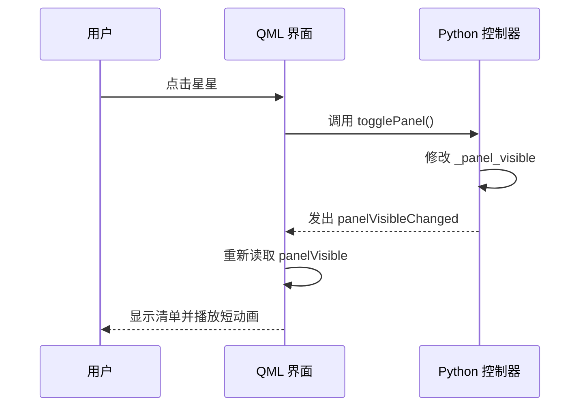

# 第 1 轮：让 Python 和 QML 一起工作

这一轮的目标是得到可运行的桌面入口，并理解“点击星星，清单就打开”的完整过程。

## 1. 从哪里开始运行

```powershell
uv run main.py
```

uv 选择项目的 Python 环境，再执行 main.py。入口文件很短：导入 stardot.app.main，然后调用它。

`if __name__ == "__main__"` 表示：直接运行这个文件时启动应用；被其他 Python 文件导入时，不立即弹出窗口。

## 2. QApplication 与事件循环

`QApplication` 负责窗口、输入和应用生命周期。这一轮还使用 Qt 的托盘菜单，所以选择支持 Widgets 的 QApplication；主要界面仍由 Qt Quick 绘制。

创建窗口后调用 `app.exec()` 进入事件循环。Qt 等待点击、按键、重绘等事件，有事件时调用对应处理逻辑。我们无需自己写一个不断刷新界面的 while 循环。

程序只有退出后，`exec()` 才返回。关闭清单只是收起一个窗口，退出需要通过托盘菜单或 Ctrl + Q。

## 3. QML 描述“界面长什么样”

`stardot/qml/Main.qml` 描述窗口、文本、按钮和布局。

例如：

```qml
visible: starWindow.controller.panelVisible
```

这是属性绑定：窗口是否显示，取决于 Python 对象的 panelVisible。它会随着属性通知更新，不是只在启动时复制一次值。

星星图形位于 `stardot/assets/star.svg`，`StarMascot.qml` 将它变成可复用组件，并提供短暂的悬停动画。

## 4. Python 怎样通知 QML

`AppController` 中有三类要素：

| 要素 | 示例 | 作用 |
| --- | --- | --- |
| 属性 Property | panelVisible | 让 QML 能读取 Python 中的状态 |
| 信号 Signal | panelVisibleChanged | 告诉 QML 状态已变化，应更新绑定 |
| 槽 Slot | togglePanel() | 让 QML 能调用 Python 的操作 |

完整过程：



关闭按钮和 Escape 都调用同一个 hidePanel()，避免不同入口修改状态的规则不一致。

## 5. 为什么保留一个 Runtime 对象

Qt 的窗口、引擎、托盘和菜单都有生命周期。Runtime 把重要对象放在一起保留引用，避免局部变量结束后对象意外被回收，也方便验证程序读取它们。

## 6. 怎样验证

- 用真实鼠标点击星星，检查清单打开和收起。
- 拖动星星到屏幕两侧，检查清单跟随并选择合适方向。
- 检查 × 和 Escape 收起清单，托盘菜单正常退出。
- 离屏检查脚本额外验证 QML 加载、事件连接和边缘坐标，并生成截图。

## 7. 这一轮的边界

这一轮建立 UI 和事件连接，界面呈现空清单。后续再依次加入任务数据、可靠保存、跨应用录入、概要与日期等。

建议先阅读顺序：main.py → app.py 的 main/create_runtime → AppController → Main.qml。一次不必读懂所有窗口 flags 和坐标代码，先理解上面的点击流程。
