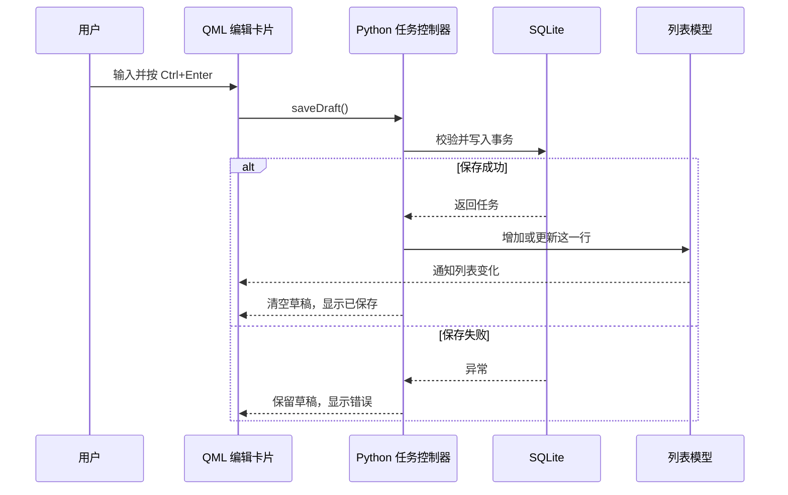

# 第 2 轮：星星修正、任务模型与本地保存

本篇保留第 2 轮的实现记录。单击编辑、双击原文、删除及日期等新版操作以[第 3 轮](lesson-03-capture-and-dates.md)为准。

本轮已经让星点可以记录真实任务。运行命令仍然是：

```powershell
uv run main.py
```

## 1. 先体验这一轮的结果

1. 退出旧版进程，再运行。星星的五个外角更圆，暖金色稍亮。
2. 鼠标移到星星上，观察眼睛睁大、边缘微亮；整体保持位置和角度不变。
3. 将星星拖到屏幕各边，松开后，完整的星星会自动回到可用区域。
4. 点击星星 → + → 输入一条任务 → Ctrl + Enter 保存。
5. 双击卡片修改文字，点对勾保存；正文与初始内容不同时可以展开“原文”。
6. 勾选任务，看划线、归档与星星表情；通过文件夹查看归档，再点勾恢复。
7. 完成或恢复后，可在底部 6 秒内撤销最近一次操作。
8. 退出并重开，检查已保存任务还在。

基础文字拖放也已接通：选取能拖出的文字，拖到星星上，松手后进入编辑。星星会短暂微笑，草稿保持未保存，Ctrl + Enter 或对勾才写入任务。来源只允许复制；已有草稿时，新拖入的文字不会覆盖它。

本轮不会识别概要或日期，所以 Enter 继续用于换行。之后出现概要候选时，再接入已经确定的 Enter 确认规则。无日期任务目前也不会提醒。

## 2. 星星为什么会被屏幕遮住

第一轮只修正了清单的位置，星星的位置仍直接交给系统拖动。本轮增加了拖动结束后的检查。

例如可用区域宽 1920，星星窗口宽 84，边缘留 6 像素，那么最靠右的位置为：

```text
1920 - 84 - 6 = 1830
```

窗口坐标是左上角的位置。如果星星停在 x=1880，就把它移到 x=1830。

实际代码使用屏幕的可用矩形，处理任务栏、多屏负坐标和窗口尺寸。跨屏拖动期间先允许自由移动，松手后选择中心所在屏幕，必要时选择最近的屏幕。

`app.py` 在坐标变化后启动一次短计时器，移动期间只等待松手；停止后计时器也停止。Windows 使用真实鼠标按键状态，避免原生窗口移动接管事件后，Qt 没收到松开事件。

坐标计算单独放在 `geometry.py`，这样不用真的移动显示器，也能验证负坐标、屏幕断开等边界。

## 3. 表情与轮廓为什么分开

- `star-body.svg`：圆润的星形和暖金渐变。
- `star-rim.svg`：高亮轮廓。
- `StarMascot.qml`：眼睛、腮红和嘴巴。
- `star.svg`：托盘使用的静态完整图标。

悬停时只改变眼睛高度和轮廓透明度。接收和完成任务由 Python 发出反馈信号，QML 显示约 900 毫秒的表情，再恢复自然状态。待机时没有循环动画。

## 4. 这一次多了哪几层

| 文件 | 职责 |
| --- | --- |
| `TaskEditor.qml`、`TaskCard.qml` | 编辑卡片、任务卡片与点击操作 |
| `tasks.py` | 草稿、保存、完成、归档、撤销等规则 |
| `task_model.py` | 把 Python 任务提供给 QML 列表 |
| `storage.py` | SQLite 读写和事务 |



界面仍然使用第一轮的属性、信号和槽；这次把它们用在真实数据上。

## 5. 为什么需要“列表模型”

Python 的普通 list 发生变化时，QML 不会自动知道哪个任务增加或修改了。

`QAbstractListModel` 是两者之间的接口。它告诉 QML 有多少行、每行的正文和完成状态，并用插入、移动、移除或数据变化通知更新列表。QML 的 `ListView` 使用同一份 `TaskCard` 模板生成各张卡片。

本轮只更新改变的行，已有卡片和滚动位置尽量保留。你先理解“数据变化需要通知界面”即可，之后再细看每个模型方法。

## 6. SQLite 事务与原文保存

SQLite 把任务存放在本机文件中，Python 标准库的 `sqlite3` 就可以读写。数据库位置由 Qt 获取，Windows 默认在：

```text
%LOCALAPPDATA%\Stardot\stardot.sqlite3
```

每条任务有稳定 ID、正文、初始原文、创建时间和完成时间。编辑正文时只更新正文列；完成任务只更新完成时间，归档没有复制出第二条任务。

写入形如：

```python
with connection:
    connection.execute(
        "UPDATE tasks SET body = ? WHERE task_id = ?",
        (body, task_id),
    )
```

`?` 代表参数，文字里的引号不会变成 SQL 指令。`with connection` 在成功时提交、异常时回滚；它不会关闭连接，退出应用时仍要显式 close。

保存失败时保留草稿；未知的新版本数据库会被拒绝打开，不会清空旧数据重新建库。备份导出与恢复入口将在后续模块补齐。

## 7. 完成后立刻撤销，为什么也要测试

完成任务后，数据库先提交完成状态，卡片展示约 220 毫秒的划线，再退出待办列表。

如果在这段时间撤销，旧计时器不能把任务重新标成完成。因此计时器只负责刷新当前列表，不重新写入旧状态；删除线也读取模型中的完成状态。数据库、模型和卡片保持一致。

## 8. 已运行的检查与仍需实机体验的部分

自动检查使用临时数据库，与用户任务隔离。

| 项目 | 本轮验证 |
| --- | --- |
| SQLite | 重开后读取、中文／引号／表情、编辑保留原文、完成与恢复 |
| 失败情况 | 空白与过长文字、写锁、写保护、未知数据库版本 |
| 位置 | 四周越界恢复、负坐标屏幕、跨屏选择及断屏后的最近屏幕 |
| QML | 点击、双击编辑、Esc、Ctrl + Enter、长文字与列表滚动 |
| 拖放 | 向 Qt 发送文字 MIME 事件，只接受复制，不覆盖已有草稿 |
| 输入法 | 模拟预编辑期间不能误保存，提交文字后可保存 |
| 状态 | 完成表情、归档、恢复及过渡期间撤销 |
| 模型 | Qt 列表模型一致性检查 |

截图保存在 `artifacts/ui/`。这些截图中的示例任务仅来自测试数据库。

真实 Windows 拖动松开、任务栏位置、混合缩放、实际中文输入法、Edge 和微信的拖出能力还需要桌面体验。模拟拖放成功并不能保证来源应用的所有区域都提供文字拖放。

## 9. 建议阅读顺序

先看 `tasks.py` 的 `saveDraft()`，再看 `storage.py` 的 `add()`，最后回到 `TaskEditor.qml` 找到 Ctrl + Enter 的处理。把一条任务如何从输入框走到数据库理解清楚，再读归档和列表模型。

参考：[Qt 列表模型](https://doc.qt.io/qtforpython-6/PySide6/QtCore/QAbstractListModel.html)、[Qt DropArea](https://doc.qt.io/qt-6/qml-qtquick-droparea.html)、[Python sqlite3](https://docs.python.org/3/library/sqlite3.html)。
