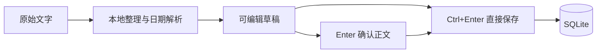

# 第 3 轮：原文交互、归档删除、概要与日期

> 本文记录第 3 轮实现。日期选择、卡片切换和关闭保存的最新行为见[第 4 轮讲解](lesson-04-interaction-polish.md)。

## 1. 本轮如何体验

先退出旧版进程，再执行：

```powershell
uv run main.py
```

| 操作 | 新版行为 |
| --- | --- |
| 悬停／拖入文字 | 星星睁眼，暖色微光渐渐亮起，离开后淡出 |
| 单击卡片正文 | 打开编辑 |
| 双击编辑区正文 | 就地显示只读原文，再双击返回；草稿不被替换 |
| 删除归档 | 卡片右侧垃圾桶删除，6 秒内可撤销最近一次操作 |
| Enter | 灰色候选时接受概要为正文，不保存；已确认后换行 |
| Ctrl + Enter／对勾 | 直接保存当前正文和日期，无需单独确认候选 |
| 日期 | 点击输入，或指向月／日／时／分滚轮调整 |
| 日期旁 × | 清除日期和时刻，本次编辑期间不会自动填回来 |

没有额外的原文按钮。任务正在编辑时先保存或取消，再删除；删除只针对归档，待办没有删除入口。

## 2. 先用这段文字试一遍

```text
大家好！
提醒：明天下午三点带预算表开会。
谢谢大家！
```

从支持纯文字拖放的区域拖入星星，预期得到：

- 灰色正文：明天下午三点带预算表开会。
- 日期：录入当天的次日，15:00。
- 原文：完整保留上面的三行。

按 Enter 后正文恢复正常颜色，任务仍未保存。按 Ctrl + Enter 才保存。也可以直接 Ctrl + Enter，跳过单独确认概要。

本轮在拖入时提供概要候选；手动输入及粘贴到编辑框的文字保留用户输入，同时提取日期。全局复制快捷入口尚未加入。

## 3. “识别”与“保存”分开

`text_processing.py` 是不依赖界面的普通 Python 模块：

```python
result = capture_text(text, reference_time)
```

它接收文字和参考时间，返回候选正文、日期、时刻及必要的歧义说明，不写数据库、不打开窗口。

`TaskController` 再把结果放入草稿。只有 saveDraft() 才写入 SQLite。这样可以直接用单元测试检查识别规则，不需要为每一个日期样例启动图形界面。



## 4. 这一版的概要范围

当前是保守的文字整理：清理开头明确的“大家好”“任务：”“提醒：”等包裹语、结尾的独立致谢，以及多余空白。

条件、否定、地点、附件等信息保留。例如“如果方案没通过，不要发送预算；先找小王核实”不会只留下“发送预算”。复杂长消息不强行截取前几十个字，会保留全文供编辑。

这还不是通用长文摘要模型。实际样例需要继续积累；如果整理效果不足，再评估更强的抽取或模型方案。本轮没有新增联网服务或模型依赖，内容在本机处理。

## 5. 日期规则与边界

| 表达 | 本轮处理 |
| --- | --- |
| 今天、明天、后天 | 按本次录入的本地日期计算 |
| 本周五、这周五 | 当前自然周的周五，可以是过去日期 |
| 下周一、下星期一 | 下一个自然周的周一 |
| 周五、星期五 | 从录入当天起最近的对应星期，包含当天 |
| 2026-09-18、2026/9/18、2026年9月18日 | 使用给出的年月日 |
| 9月18日、9/18 | 使用录入当年的年份，不擅自推到下一年 |
| 15:30、下午三点半、上午九点十分 | 有明确日期时填入具体时刻 |
| 明天下午 | 只填日期，不把“下午”猜成某个小时 |
| 明天三点 | 只填日期；上午／下午不明确，不猜时刻 |
| 单独 15:30 | 不补日期；可在小日历中手动设置 |
| 明天或后天、9月18日至20日 | 日期留空，允许手动设置 |
| 大概明天、每周五 | 模糊或重复安排不转成单次任务日期 |
| 明天14:00到16:00 | 日期保留，时刻留空，不随意选一个端点 |
| 不存在的日期，例如 2026-02-30 | 不填入无效日期 |

解析范围不是完整自然语言理解，未覆盖的写法需要手动检查和设置。当前日期时间按本机本地时间处理，没有跨时区换算。

悬停日期可查看完整年月日；必要的歧义说明在小日历的提示中查看。页面不常驻大段解释。

## 6. 为什么“取消日期”需要记住

草稿保存一个“用户已手动设置日期”的标志。用户点击取消、滚轮调整或手动输入日期后，后续正文变化不会重新覆盖日期。

手动新建时，文字停止变化 350 毫秒后识别日期；如果很快按保存，会先处理最新文字再保存。它不会在输入过程中不断改写正文。

重新编辑已保存的任务时，保留已保存日期，不重新解释原文里的“明天”。这样旧任务不会每打开一次就向后漂移一天。

## 7. 日期颜色与资源占用

- 已逾期：黑色。
- 今天：橙色。
- 明天：赭黄色。
- 后天及以后：暖绿色。

只有日期的任务在当天结束后算逾期；有时刻的任务按具体时刻比较。任务卡片只显示日期／时间，不常驻倒计时。

颜色在打开面板时更新，面板可见期间每分钟检查一次；面板隐藏后停止这个计时器。本轮只记录和展示日期，尚未发送通知。

微光使用多层低透明度矢量描边和颜色渐变，配合短暂透明度过渡；无需持续重绘大型模糊。

## 8. 删除与数据库升级

归档删除在事务里执行，先确认任务确实已完成。撤销保存一份包含 ID、正文、原文、创建时间、完成时间和日期的快照，恢复时使用原 ID，不新建另一条任务。仅支持最近一次操作；超过撤销时间或退出程序后，这份内存撤销记录不保留。

数据库从 v1 升到 v2，新增 due_date 和 due_time 两列。升级已有数据库前，用 SQLite 的备份接口生成同目录备份，然后在事务中添加字段。备份命名：

```text
stardot.before-v2-随机编号.sqlite3
```

升级保留原有任务；再次启动不会重复升级。正式的备份导出／恢复界面仍待后续模块实现。

## 9. 验证结果

本轮 18 项单元测试通过，其中部分测试按多个日期样例逐条检查。覆盖：

- 明确日期、歧义、多日期、时长、闰年和跨月。
- 概要保留否定和条件、不截断长内容。
- Enter 确认与直接保存；手动修改／取消日期后不被覆盖。
- 归档删除失败、撤销、原文与日期完整恢复。
- v1 数据库升级、升级前备份可读取、重开后日期保留。

离屏交互检查还实际发送了点击、双击、键盘、拖放和滚轮事件，验证原文切换、删除撤销、灰色候选、日期弹窗、月份滚轮和日期取消。截图位于 artifacts/ui/。测试使用临时数据库，不修改日常任务。

实际 Windows 输入法、Edge／微信拖放、混合缩放仍需要实机体验，离屏事件测试不能替代这些兼容性验证。

## 10. 建议先读哪几段

1. `text_processing.py` 的 capture_text()：理解纯函数如何返回识别结果。
2. `tasks.py` 的 receiveText()、acceptSummary()、setDraftSchedule()：看草稿状态如何变化。
3. `TaskEditor.qml` 的按键处理：看 Enter 与 Ctrl + Enter 如何分工。
4. `storage.py` 的版本检查：看如何给已有数据库增加字段。
