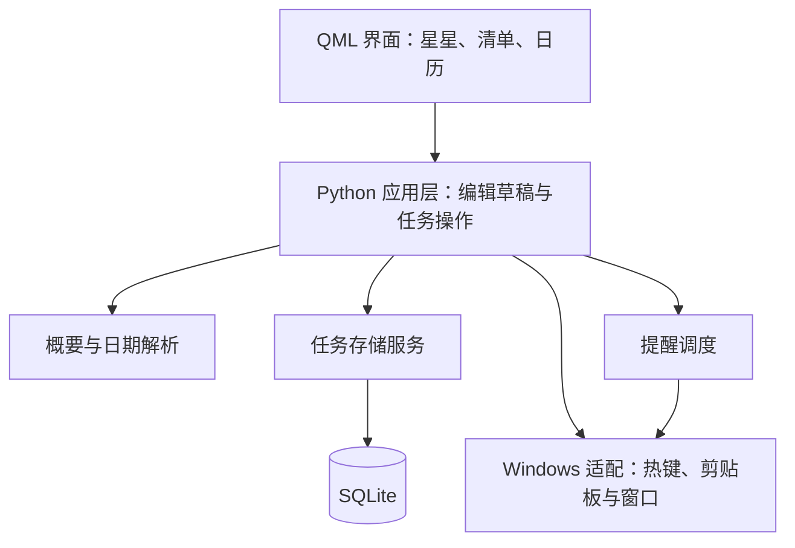

# Stardot · 星点｜技术选型与概要设计

- 版本：v0.3
- 日期：2026-09-16
- 依据：[需求说明书 v0.4](stardot-requirements.md)
- 状态：环境已完成，已实现任务与存储、基础概要整理和日期模块；系统集成、性能及发布仍待验证
- 已知基础：用户熟悉 Python、C、C++，尚未学习 HTML、CSS、JavaScript；环境由用户亲手搭建

## 1. 推荐结论

建议首版采用 **Python + PySide6 + Qt Quick/QML + SQLite**。

这是结合当前需求和学习基础作出的工程判断。重点是在用户熟悉的 Python 上增加界面开发能力，同时满足透明星星窗口、定制卡片、日历和动画需求。系统集成、发布与实际资源占用通过早期小型验证确定。

| 部分 | 推荐技术 | 用途 |
| --- | --- | --- |
| 业务逻辑 | Python | 任务、日期、概要、归档、提醒调度与备份 |
| 桌面框架 | PySide6 | 从 Python 使用 Qt 6 的窗口、输入、模型和系统能力 |
| 界面 | Qt Quick + QML | 描述星星、卡片、日历、布局和状态动画 |
| 本地数据 | SQLite，优先使用 Python 标准库 sqlite3 | 事务保存任务，支持查询、备份和恢复 |
| 项目与环境管理 | uv | 管理 Python 版本、项目依赖、锁文件和 .venv |
| Windows 适配 | 独立的系统适配模块 | 全局快捷键、通知、恢复事件和必要的窗口行为 |
| 发布 | 体验版使用 PyInstaller 目录模式 + Inno Setup | 本机编译器版本不满足当前 Nuitka 要求；保留后续评估 pyside6-deploy 的路线 |

PySide6 是 Qt 官方的 Python 绑定。QML 是描述界面的声明式语言：通过属性、布局和绑定表达外观，部分交互会使用少量 JavaScript。Python 和 QML 之间仍需学习 Qt 的信号、槽与数据模型。[Qt for Python](https://doc.qt.io/qtforpython-6/)

开发环境采用常规 CPython 3.13 和 PySide6 6.11.2；项目 Python 范围限定为 >=3.13,<3.14。PySide6 6.11.2 的 Python 要求是 >=3.10,<3.15，提供 Windows x64 的兼容 wheel。Python 补丁版本及打包工具组合在实际环境中记录和验证。[PySide6 6.11.2 发布信息](https://pypi.org/project/PySide6/6.11.2/)

## 2. 候选方案比较

下表是针对 Stardot 的判断，不是通用性能排名。

| 方案 | 优势 | 对本项目的代价 | 结论 |
| --- | --- | --- | --- |
| Python + PySide6 + Qt Quick | 沿用 Python 基础；定制界面和动画；业务与视图能清楚分离 | 需学习 QML 和 Qt 模型；Windows 通知与热键需要适配；发布包含 Python/Qt 依赖 | 首推，先验证关键交互与发布 |
| C++ + Qt Quick | 沿用 C++ 基础，界面能力同属 Qt Quick | 需要处理编译、链接、依赖与对象生命周期；当前业务未显示必须由 C++ 执行的性能需求 | 有明确需求时再考虑采用 |
| C# + WPF | Windows 拖放和窗口集成直接；自定义矢量、样式和动画能力完整 | 需补 C#、XAML 与数据绑定；WPF 界面仅支持 Windows | 最强备选，Qt 的系统集成验证不通过时优先评估 |
| Tauri 2 + Web 前端 | CSS/SVG 定制方便；可用系统 WebView；有桌面插件 | 需补网页前端、TypeScript 和部分 Rust；WebView2 有运行成本；文字拖放与通知存在平台边界 | 将来若以学习 Web 或跨桌面为重点，再重新比较 |
| Electron + Web 前端 | 桌面 API 与 Web 工具链成熟，渲染环境一致 | 自带 Chromium 与 Node；对当前常驻小工具增加运行基础和新的学习内容 | 本轮不优先 |

相关事实依据：

- Qt Quick 使用场景图及图形 API 渲染，能将图形渲染工作交给 Qt；不能由此推导业务计算不会阻塞界面。[Qt Quick Scene Graph](https://doc.qt.io/qt-6/qtquick-visualcanvas-scenegraph.html)
- WPF 支持矢量、动画、样式和模板，运行平台为 Windows；其能力足以支持当前视觉目标。[WPF 概述](https://learn.microsoft.com/en-us/dotnet/desktop/wpf/overview/)
- Tauri 借用系统 WebView。Windows 中使用前端 HTML5 拖放时，需要关注默认 dragDropEnabled 对 WebView2 拖放的接管。[Tauri WebView 版本](https://v2.tauri.app/reference/webview-versions/)、[Tauri 配置](https://v2.tauri.app/reference/config/#dragdropenabled)
- Electron 将 Chromium 与 Node.js 打包到应用中。[Electron 概述](https://www.electronjs.org/docs/latest)

安装包体积、运行内存和启动速度分别测量，不用其中一个指标代替另外两个。

## 3. 总体结构

- 界面负责展示和收集操作，不直接拼 SQL 或操作 Windows 消息。
- 同一进程内，由应用层维护权威任务状态；清单、归档和日历读取同一数据模型。
- 数据库写入成功后再确认保存；失败时保留编辑内容并反馈。
- 原文与编辑后的任务正文分开保存。
- 文本解析保持独立，便于用样例测试和替换实现。

SQLite 不需要独立数据库服务器；Python 的 sqlite3 模块提供访问与备份接口。建议先使用直接、参数化的 SQL 和少量存储方法，不为首版引入额外数据库服务。[Python sqlite3](https://docs.python.org/3/library/sqlite3.html)

## 4. 窗口和视觉实现

### 4.1 两个主要窗口角色

1. **星星窗口**：小型透明无边框窗口，承担显示、移动、点击与文字接收。
2. **内容窗口**：按需打开，在窄清单与居中日历之间切换，避免两种视图同时展开。

当前优先验证用同一个内容窗口切换视图和几何位置；如果透明边缘、焦点或缩放行为不稳定，可调整为独立内容窗口，但保持产品表现不变。

Qt 的 Window 支持透明颜色与窗口 flags。视觉透明与鼠标点击穿透是不同问题，星星周围的接收范围必须实测。[QML Window](https://doc.qt.io/qt-6/qml-qtquick-window.html)

### 4.2 绘制和动画

- 星星使用可缩放的形状或矢量资源，表情与局部动画由 QML 控制。
- 任务卡片和月历使用定制布局与组件；日历只加载当前可见月份的必要数据。
- 优先通过位移、缩放、透明度等属性做短动画，避免持续重算整个界面。
- 静止时不维持无意义动画；大型模糊与阴影通过实际效果和资源测量决定是否采用。
- 多窗口、不同刷新率和混合缩放均需实测，不能仅靠单窗口预览判断流畅度。

## 5. 录入与 Windows 集成

### 5.1 拖放与剪贴板

- 用 QML DropArea 接收进入、离开与投放事件；在兼容来源交付的 MIME 数据中优先读取纯文本。
- 拖到星星上只显示接收反馈，松手后复制数据并打开编辑卡片。
- 外部 HTML 如用于获取可读文字，应转换为纯文本，不作为可执行界面载入。
- Edge 普通网页、Edge 内的消息页面、微信消息分别验证；来源未提供拖放文字时走复制入口。
- 剪贴板仅在用户主动触发录入时读取，不需要持续扫描。

Qt 提供拖放接收区域，但不能使来源应用凭空支持文字拖出。[QML DropArea](https://doc.qt.io/qt-6/qml-qtquick-droparea.html)

### 5.2 全局快捷键与托盘

- 应用内的 Enter、Ctrl + Enter 与输入法状态通过 Qt 输入系统处理。
- 跨应用快捷键使用 Windows RegisterHotKey，并通过 Qt 原生事件过滤器接收 WM_HOTKEY；退出时注销，冲突时提示重新设置。
- 托盘作为隐藏后的找回与退出入口，使用 QSystemTrayIcon；QML 仍负责主界面。

QShortcut 的应用快捷键不能直接等同于系统全局快捷键。Qt 原生事件过滤器明确支持接收 Windows 热键消息。[QShortcut](https://doc.qt.io/qt-6/qshortcut.html)、[RegisterHotKey](https://learn.microsoft.com/en-us/windows/win32/api/winuser/nf-winuser-registerhotkey)、[QAbstractNativeEventFilter](https://doc.qt.io/qt-6/qabstractnativeeventfilter.html)

## 6. 概要与中文日期

### 6.1 概要：先验证本地抽取是否满足需求

建议首轮实现保守的本地抽取：清理格式、识别任务句，优先保留原文中的完整意思，形成灰色正文预览。

- 不简单用“前若干字”替代概要。
- 保留否定、条件、对象和关键地点，避免截取后改变意思。
- 无把握时保留原文供编辑。
- Enter 接受概要，Ctrl + Enter／对勾直接保存当前正文。
- 用户开始编辑后，识别结果不得覆盖用户修改。

抽取式概要可以选取和精简原句；生成式模型可以进一步改写，但会引入新的延迟、资源或联网条件。本轮推荐先验证抽取式效果，不默认部署大模型或上传录入内容。若真实样例表明抽取不能满足已确认需求，再比较模型方案，不能把简单截断算作功能完成。

### 6.2 日期：受限明确规则优先

建议 Python 路线先覆盖约定的明确表达，例如数字日期、“明天／后天／本周五／下周一”和“下午三点”等，再用真实样例扩充。日期计算交给标准日期工具；中文文本匹配和产品规则独立实现。

- 日期与时刻分开存储：只有日期时，时刻保持空值，不安排提醒。
- “明天下午”不能擅自变成“明天 15:00”。
- 时长、多日期和多任务内容不能直接取第一个数字当截止时间。
- 相对日期以本次录入的参考时刻解析，避免跨午夜编辑时漂移。
- 用户主动修改或取消日期后，后续识别不得悄悄覆盖。
- 明确日期自动填入，可修改或取消，无日期候选确认步骤。

可以评估成熟解析库作为补充，但 Microsoft Recognizers-Text 官方将 Python 版本标为 alpha，主要支持矩阵基于 .NET；不能直接假设各语言实现同等成熟。JS 路线中的 chrono 也明确将中文标为部分支持。[Recognizers-Text](https://github.com/microsoft/Recognizers-Text)、[chrono](https://github.com/wanasit/chrono)

首轮以约 10 条用户实际使用的脱敏内容和一组边界样例评估正文、日期、时刻与提醒资格。样例暂缺时可先准备示例，不宣称已达到实际使用质量。

## 7. 提醒与数据可靠性

### 7.1 调度与通知分开

- Python 提醒服务维护下一次到期时间；使用事件和计时器调度，避免高频轮询所有任务。
- 任务变更时重算提醒；完成、删除或取消时间后，旧提醒失效。
- 启动和睡眠恢复后重新核对当前时间与数据库中的提醒，合并处理遗漏。
- 在唤醒和发送时再次检查任务状态；记录本次提醒处理结果，避免重复补发。
- Qt 的托盘消息可用于验证即时提示，但不能承担“退出应用后仍准时提醒”的产品承诺。

Windows 系统通知通过单独适配层接入。若需要完全退出后仍通知，则需验证 Windows 原生计划通知、安装身份和激活流程；是否需要额外桥接由原型结果决定，需求中的该项目前仍待定。[Qt 托盘消息](https://doc.qt.io/qt-6/qsystemtrayicon.html)、[Windows 通知](https://learn.microsoft.com/en-us/windows/apps/develop/notifications/app-notifications/)、[Windows 计划通知](https://learn.microsoft.com/en-us/windows/apps/develop/notifications/app-notifications/app-notifications-scheduled)

### 7.2 保存与备份

- 任务操作使用事务；原文、正文、日期、时刻和完成状态同步保存。
- 备份使用数据库备份接口或明确一致性的导出流程，避免只复制可能正在写入的数据库主文件。
- 恢复先校验格式和版本，避免静默覆盖损坏数据。
- 数据文件放到应用数据目录；开发目录和安装目录不承担用户数据存储。

## 8. 第一个技术验证阶段

用户搭好选定环境后，先写小型验证程序，再开展完整功能开发。

| 验证项 | 必须观察的结果 |
| --- | --- |
| 透明星星窗口 | 显示、拖动、置顶、隐藏找回、可投放范围和边缘定位正常 |
| Edge／微信录入 | 区分实际能拖出的场景，复制快捷入口可用，原文不被移动 |
| 输入法与确认 | 中文选词正常；Enter 接受概要；Ctrl + Enter 只保存一次 |
| 清单／日历 | 切换位置与尺寸正确；关闭日历只保留星星；跨屏缩放可用 |
| 概要与日期 | 对照样例检查语义、歧义、无时刻和用户手动修改 |
| 通知 | 从打包后的程序验证即时通知、标识、睡眠恢复与退出边界 |
| 资源与发布 | 测量待机、展开、收起和长时间运行；在无开发环境条件下启动打包程序 |

若框架在关键系统交互上存在不可接受的问题，先评估原生适配成本，再决定是否改用 WPF；不同时完整开发多套界面。

资源验证记录整个应用相关进程、CPU、内存、GPU 表现、冷启动和重复展开时间。具体预算在目标电脑测量后制定，不承诺未经实测的 MB 或帧率。

## 9. 环境与学习顺序

环境由用户亲手操作并使用 uv 管理，助手解释每一步并排错。已知当前系统默认 Python 为 3.8.10，本机已安装 uv 0.11.7；本项目使用独立的 Python 3.13 环境。

1. 使用 uv 安装常规 Python 3.13，并在本项目固定主次版本。
2. 使用 uv 项目模式建立 pyproject.toml，由 uv 管理 .venv 和 uv.lock。
3. 使用 uv add 安装并锁定 PySide6，通过 uv run 验证 Python、PySide6 与 QtQuick 导入，再运行最小 Qt Quick 窗口。
4. 配置编辑、运行和调试方式；建立版本控制。
5. 验证打包工具链，再逐步学习 QML 属性、布局、信号、模型与 Python 交互。

PySide6 wheels 包含 Qt 二进制，通常无需先编译整个 Qt。发布时仍需处理所需 Qt/QML 资源与依赖；官方 pyside6-deploy 基于 Nuitka，Windows 的依赖分析涉及 MSVC 工具。开发环境可运行不等于发布程序已验证。[Qt for Python 入门](https://doc.qt.io/qtforpython-6.8/gettingstarted.html)、[pyside6-deploy](https://doc.qt.io/qtforpython-6/deployment/deployment-pyside6-deploy.html)

环境文件分工：

| 文件或目录 | 作用 |
| --- | --- |
| pyproject.toml | 项目名称、Python 支持范围和直接依赖 |
| .python-version | 告诉 uv 在本项目选择哪个 Python 版本 |
| uv.lock | 记录解析出的依赖版本及下载信息，便于复现环境 |
| .venv | 本机项目虚拟环境，可根据项目配置和锁文件重新创建 |

日常使用 uv add 管理依赖、uv run 运行程序、uv sync 根据配置和锁文件同步环境。uv 会按项目自动创建或同步环境，无需每次手动激活。版本控制应保留项目配置、版本文件和锁文件，忽略 .venv。[uv 项目指南](https://docs.astral.sh/uv/guides/projects/)、[uv Python 版本管理](https://docs.astral.sh/uv/concepts/python-versions/)

环境完成后，助手按小功能实现并同步解释关键代码、设计取舍和验证结果；用户参与运行验证及逐步修改。教学以 Python 业务逻辑和 QML 视图为两条线，不等整个应用完成才集中讲解。

## 10. 当前结论与后续决定

- 按 Python + PySide6 + Qt Quick/QML + SQLite 路线推进，使用 uv 管理项目；当前环境准备由用户执行。
- 技术验证后才能确认微信拖放覆盖范围、通知方案、发布可行性和资源预算。
- 提醒默认规则、时间语义等产品问题仍按需求说明书记录，技术选型不替用户悄悄决定。
- 手机同步不进入本轮。数据层与界面分离有利于后续扩展，但不保证未来手机端可以直接复用桌面界面。

## 11. 第 3 轮落地记录

- 使用纯 Python 本地规则整理概要候选、解析约定范围的明确日期；具体支持与退让规则见[第 3 轮讲解](lesson-03-capture-and-dates.md)。
- 草稿区分概要待确认状态和日期手动设置状态，避免 Enter 误保存、日期取消后被覆盖。
- 数据库 v2 增加 due_date、due_time，升级前用 SQLite backup 接口保留旧库，迁移在事务内执行。
- 归档删除与撤销保留原任务身份及所有字段；日期颜色在面板显示时更新。
- 此处为第 3 轮历史记录；提醒、日历、全局复制快捷键和备份恢复已在第 6 轮实现，见下节。

## 12. 首版落地记录（2026-09-20）

- 新增 `reminders.py` 调度和去重；通过 Qt 托盘发送本机通知，保持运行时提醒，退出／关机后下次启动补发。默认提前 10 分钟由用户确认。
- 新增 `calendar.py` 与按需创建的 `CalendarWindow.qml`，共享任务数据；关闭释放窗口，不自动弹回清单。
- 新增 `desktop.py`：Windows 原生快捷键、冲突回滚、恢复／时间变化事件、设置持久化、位置记忆和备份入口。
- 数据 v3 增加提醒设置与发送记录；一致性备份、只读校验、恢复确认和恢复前自动备份。
- `QLockFile` 与 `QLocalServer` 保证同一数据目录只有一个实例，重复启动激活原窗口。
- 后续发布沿用体验版已验证的 PyInstaller + Inno Setup；当前工具链不依赖新增 C++ 编译器。版本资源、锁文件和安装说明同步为 1.0.0，按用户要求本轮仅交付源码，未构建新版产物。
- 详细代码讲解、性能测量及验收边界见[第 6 轮记录](lesson-06-first-release.md)。
